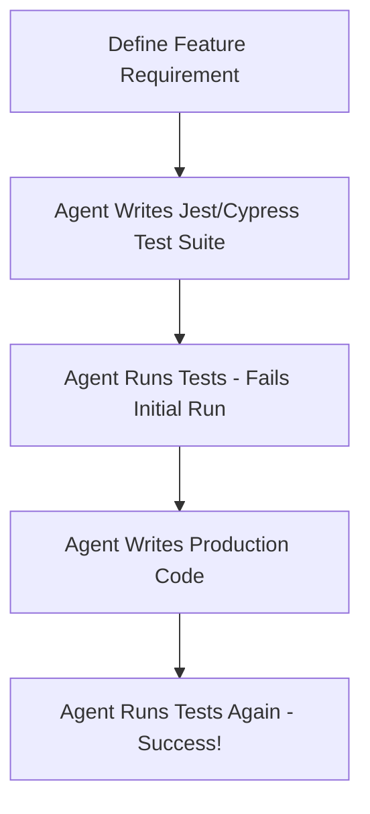

# How Silicon Valley Developers Leverage Antigravity

Silicon Valley engineers don't just use AI as a smart autocomplete or a simple chat assistant. They treat advanced agentic coding assistants like **Antigravity** as **Senior Software Engineering Partners**. 

Because Antigravity can read the entire workspace, write and edit files directly, execute terminal commands, run test scripts, and perform live web searches, developers use it to automate complex, multi-step engineering loops.

Here is the blueprint of the exact strategies and workflows they use to scale their productivity by 10x.

---

## 1. Autonomous Debugging & Verification Loop
Instead of manually adding console logs, rebuilding the app, and guessing why an API call is failing, top-tier developers delegate the entire debugging cycle.

> [!TIP]
> **The Workflow:**
> 1. Provide the error message or describe the buggy behavior.
> 2. Ask the agent to write a **scratch test script** (just like we did for Delhivery today).
> 3. Let the agent execute the script via the terminal, analyze the raw response, and identify the root cause.
> 4. Instruct the agent to apply the code fix and run the script again to verify the fix before pushing.

### 💡 Example Prompt:
> *"I am getting a payment failure during checkout on the live site. Write a standalone Node.js script in the scratch directory to mock the payment gateway payload, execute it via terminal, diagnose the error, and fix the codebase once you find the issue."*

---

## 2. Complete Technology Migrations
Manually rewriting codebases during migrations (e.g., changing payment gateways, auth providers, or database schemas) is tedious and prone to human error. SV developers use agentic assistants to scan the entire directory and refactor the entire system systematically.

> [!IMPORTANT]
> Because the agent understands the file tree, it can perform multi-file edits simultaneously, keeping types intact.

### 💡 Example Prompt:
> *"We need to migrate our database layer from Firebase to Supabase. Scan the codebase for all Firebase references, write a migration plan, map the database schemas, write the new Supabase client helpers, and refactor all components using the new client."*

---

## 3. Agentic Test-Driven Development (TDD)
Writing tests is critical for shipping robust products, but it is time-consuming. Silicon Valley devs use agents to write test suites *first* and then build the code to pass those tests.

### 💡 Example Prompt:
> *"I need a dynamic coupon discount feature. First, write a Jest unit test suite covering percentage discounts, flat discounts, expiry dates, and usage limits. Once done, write the actual utility functions, run the test command, and don't stop until all tests pass."*

---

## 4. Premium Aesthetic Prototyping & Design Systems
SV developers build highly polished, interactive interfaces by combining the agent's styling power, component structure, and image generation assets.

> [!NOTE]
> Instead of building barebones MVPs, developers prompt the agent to build fully responsive, premium visual layouts utilizing modern libraries (like Framer Motion) and dynamic dark modes.

### 💡 Example Prompt:
> *"Build a gorgeous product detail page for our luxury store. Use a clean, editorial layout with Outfit typography, custom glassmorphism containers, smooth micro-animations on hover using framer-motion, and a dark mode toggle that functions flawlessly across all components."*

---

## 5. Automated Security & Performance Audits
Maintaining security and performance standards is critical before production deployments. Devs use the agent's capability to search the web for latest vulnerabilities and scan local packages.

### 💡 Example Prompt:
> *"Scan my package.json for outdated or insecure dependencies. Search the web for any critical CVEs related to these packages, and write an optimization report detailing how we can decrease our bundle size and improve API response times."*
